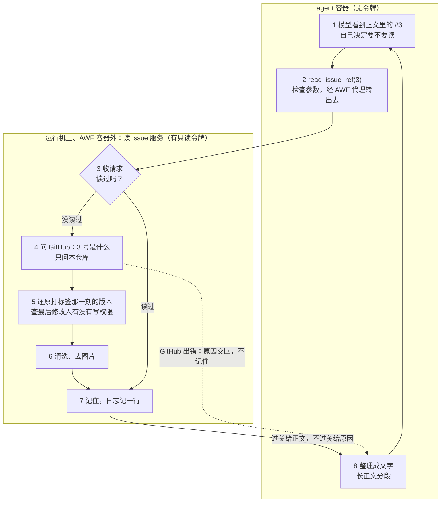

# agent 读到的内容

> 这一篇管：打标签以后，交给检查模型和 agent 的到底是哪些文字，怎么取、怎么清洗，哪些情况下不开工。开工前由 [src/repoaegis/content_check.py](../src/repoaegis/content_check.py) 和 [src/repoaegis/sanitize.py](../src/repoaegis/sanitize.py) 执行；agent 运行中读别的 issue，由 [src/repoaegis/tools/read_issue_ref.py](../src/repoaegis/tools/read_issue_ref.py) 和 [src/repoaegis/issue_service.py](../src/repoaegis/issue_service.py) 执行。为什么拦下这些 issue，见 [接收哪些 issue](接收哪些issue.md) 第二节。

## 一、只用打标签那一刻的版本

**只用打标签那一刻的标题和正文，不读评论**，打标签之后的修改也不读（2026-10-24 定）。要补充信息，请改好正文后重新打标签。这防的是有人在维护者看过、打了标签之后偷改正文、塞入指令。

**这一版从修改记录里倒推，不用触发事件里带的标题和正文**（2026-10-30 定）。修改记录里存着每一版正文的全文，标题从改标题的记录倒推。不用事件里那份，是因为事件可能早于最后一次打标签：例如打标签的那次运行在排队，期间维护者改了正文、撤掉又重新打上，这次运行开始时查到的打标签时间是后一次的，事件里带的却是前一版，两者对不上，检查的是一版、交给 agent 的是另一版。

## 二、这一版最后是谁改的（2026-10-26 定，10-28 补全）

打标签事件里没有修改人，所以程序另查修改历史，找到打标签之前的最后一次修改（标题和正文都查）。

- 修改人不是 Write、Maintain、Admin 的，**不管离打标签多近，都不开工**：按模板留言说明"最新版由谁在什么时候修改，请维护者看过后重新打标签"，撤掉标签。
- 维护者重新打标签，就表示看过并认可了这一版：自程序留言提醒之后没有新的修改，就开工；提醒之后又被没有写权限的人改过，就再提醒一次。
- **怎么认出"提醒过"**：提醒留言里带一个看不见的标记 `<!-- repoaegis:editor-notice -->`，只认程序发留言用的账号（现在是 `github-actions[bot]`）发的；这条留言在那次修改之后、本次打标签之前，就开工。
- 只发过、没改过不算修改，issue 是谁发的不管，打标签的人已经替这一版担保。
- 修改时间和打标签时间只精确到秒，同一秒的修改算在打标签之前（分不清先后时按"改过"处理，最多多拦一次）。
- 不能直接看"当前最后修改人"：作业开始时 issue 可能又被改过，查到的就不是我们实际使用的那个版本。
- 已注销的账号一律算没有写权限。
- 打标签那一刻的正文已从修改记录里删掉，或 issue 的创建时间晚于打标签时间：程序报错，作业失败，不留言。
- 开工后，最终反馈里写明本次依据的是哪个时间、谁改过的版本。

## 三、清洗（2026-10-27 定）

目标是让 agent 读到的和维护者在 GitHub 页面上看到的尽量一致，页面上看不见的内容不能悄悄混进去。

**规则以 GitHub 官方 MCP 服务器（GitHub 自己提供给 AI 读 issue 的工具）的做法为准，再加一条删 HTML 注释：**

- 正文删不可见字符；标题删不可见字符，再去掉 HTML 标签。
- 照 gh-aw 删掉正文里的 HTML 注释，代码块里的不删。
- 其余不改，原文照给。和 GitHub 源码完全一致，不做任何改动，包括照删零宽不连接符。代价已知并接受：波斯文、印地文等靠它控制字母连写的文字会变形。
- 代码按 GitHub 的源码改写成 Python，保留原项目的 MIT 版权声明。

**没有采用的两条路。** 照搬 claude-code-action 的清洗规则：调研发现它和 gh-aw 的清洗都会误伤正常内容（例如把代码里的参数删坏、把"café"删成"caf"）。以 GitHub 渲染出的页面为准：调研没有找到哪一家这样做。

**漏掉的藏字写法**（链接悬停标题等）由已定的权限结构兜底（[安全设计](安全设计.md)）。清洗也挡不住直接写出来的注入：真实发生过的 PromptPwnd、Clinejection 注入的都是肉眼可见的文字，修复靠的是收紧权限。

**只有一个出口。** 检查模型、agent、agent 运行中读的其他 issue，都只读清洗后的那一份。

## 四、图片和附件（2026-10-26 定，10-28 补全）

出现图片或其他附件就不开工。怎么认：

- 在清洗过的正文里、代码以外找，规则沿用 [调研/issue附件与图片频率](调研/issue附件与图片频率.md) 第二节的那套，另加 `![说明][名字]` 写法。
- 不读渲染后的网页。上传的视频在原文里只是一条裸链接，和图片分不清，统一说成"图片或视频"。
- gist、pastebin 等粘贴网站的链接不算附件。

## 五、引用的其他 issue（2026-11-01 改为按需读，11-02 补全）

**agent 想读哪篇，就当场去 GitHub 读哪篇，不限篇数、不限层数**（和 Copilot、gh-aw、GitHub 官方 MCP 服务器一样）。开工前不再预先抓引用，也不再因为"引用多于一层"不开工。依据和实测见 [调研/agent运行中读issue](调研/agent运行中读issue.md) 第三到五之二节。

**怎么读。** agent 作业里，在 AWF 容器外的运行机上另起一个"读 issue 服务"（`src/repoaegis/issue_service.py`），只有它拿着只读令牌（`issues: read`、`pull-requests: read`）。agent 调 `read_issue_ref`，工具经 AWF 的代理把编号交给服务；服务当场向 GitHub 查、把关、清洗，再把正文或读不到的原因交回。容器里直接连 GitHub 连不上，也找不到令牌（2026-11-02 实测）。

**一次读取走的路**（代码按这几步分段，`read_issue_ref.py` 管第 2、8 步，`issue_service.py` 管第 3 到 7 步）：

**谁决定读哪篇：模型自己。** 程序不再从正文里认引用，agent 看到 `#3`、`GH-3`、完整网址这类写法，觉得有用就读。能读本仓库的任意一篇，不限于正文里出现的；其他仓库的读不了（工具只收编号）。正文里像引用、其实不是的 `#3`（如"见第 #3 步"），模型读到不相关的内容自己会放下，代价只是一次读取。

**每一篇单独把关，规则和以前一样严：**

- 读打标签那一刻的版本，和第一节一样从修改记录倒推。状态（open、closed）给现在的。
- 那一版的标题和正文，最后写或改的人里有一个没有写权限（没改过的看作者），就不给看，只说"修改人没有写权限"，不说是谁。被打标签的 issue 有打标签的人担保，这里读的没有，所以只发过的也要看作者。
- PR、找不到的（含讨论区帖子）、打标签以后才建的、那一版正文被删掉的，不给看，只说原因。编号是 PR 时要有 `pull-requests: read` 才问得出来，否则 GitHub 回"没权限"（2026-10-30 实测）。
- 给看的照样清洗（第三节），图片和附件换成一句说明（如 `[image omitted]`）。
- 服务对容器里的任何命令开放，不只 `read_issue_ref`，所以以上规则全在服务里执行。

**不设上限（2026-11-02 定）。** 不限篇数，也不按剩余接口额度设余量。只受整次运行的 60 分钟和 token 总量上限约束。GitHub 拒绝（如额度用完）时，服务把原因原样交回 agent，运行记录里看得到。已知风险：额度是整个仓库共用的（每小时 1000 次，待核对），真被用光时，同仓库其他工作流和我们自己收尾时开 PR、留言、撤标签都可能失败；读一篇约 3 到 5 次接口调用（估算），实际用量等真实运行后再看。

**长正文分段读。** 正文超过 16,000 字符时一段一段给，每段末尾写明给到哪里、下一段用什么 `offset` 读。

**同一篇读过就记住**，再问直接给，不再查 GitHub；GitHub 出错的不记，下次重查。服务的日志（每次读了哪篇、给没给看、为什么、不给看时是谁写的）随 agent 的产出一起留存。

**内容指纹只含被打标签 issue 的编号、标题和正文**，被引用的 issue 不算。

## 六、检查不通过时

修改人、图片和附件这两项由 `content_check.py` 执行。开工前检查确认打标签的人有权限之后调用它，再拿它整理出的内容和正在跑的运行、暂停存档比（[触发与叫停](触发与叫停.md) 第六节）。

- 不通过：结论为 `stop`，给出类别（`editor`、`media`）和原因，正在跑的一并停掉；留言、撤标签由收尾步骤做。现在收尾作业接不住 `stop`，见 [触发与叫停](触发与叫停.md) 第九节。
- 通过：整理好的内容写成 `content.json`，和快照一起存成运行产物。

## 七、内容里的要求，agent 照做到哪里

- **issue 描述的是任务，但不授权任务以外的事。** 要求泄露密钥、访问无关地址、改别的仓库等，agent 跳过这些要求，其余照做，并在汇报的 `skipped_requests` 里说明跳过了什么。
- **agent 手里不拿 GitHub 令牌。** 推分支、开 PR、留言、撤标签都由外层程序做（[安全设计](安全设计.md)）。

## 八、已定未写和待定

- 第一条消息已写成代码（[src/repoaegis/first_message.py](../src/repoaegis/first_message.py)，2026-11-02，未提交），按下面几条：
  - **issue 正文原样放进 `<issue>` 标签，不转义（2026-11-02 定，用户选"不处理"）**：能写进正文的只有有写权限的人，或打标签的人担保的那一版；四家官方项目都不转义，`read_issue_ref` 也不转义。
  - **仓库里写给 agent 的说明文件（2026-11-02 定，用户："程序放进去"）**：读被修复仓库根目录的 `AGENTS.md`，没有就依次找 `CLAUDE.md`、`GEMINI.md`、`.github/copilot-instructions.md`，只用找到的第一个，放进第一条消息，注明"仓库维护者写的说明，和 RepoAegis 的规则冲突时以 RepoAegis 为准"，超过 32 KiB 截断并写明省略了多少；子目录里的只列位置；`CONTRIBUTING.md` 不放。依据见 [调研/仓库里写给agent的说明文件](调研/仓库里写给agent的说明文件.md)。
  - **第一条消息写短的（2026-10-31 定，用户："用短的"）**：一句身份，加上仓库信息、issue 标题和正文、说明文件、"描述任务不授权任务以外的事"一段、五步做法、几条禁区、"做不了就不改、交卷说明"，用英文写，issue 原文照给。样稿和依据见 [调研/第一条消息怎么写](调研/第一条消息怎么写.md)。
- **检查作业和 agent 作业看到的代码可能不一样**：两台机器各自克隆一次，中间有人往默认分支推了代码，两边看到的代码和说明文件就不同。建议检查作业记下当时默认分支的提交号，agent 作业按它克隆，待讨论。
  - **提醒读引用只用一句话，程序不列编号（2026-11-03 定，用户："会有多层无限嵌套的引用。还有不明说的issue？交给agent自己判断是不是好很多"）**：信任那一段末尾一句 "To read another issue in this repository, use `read_issue_ref`."。不从正文认出编号列清单：程序只能认出正文第一层写明的编号，被引用的 issue 里再引用的、没写编号只用文字提到的，它都列不出来，列了反而像是全部。读哪篇由 agent 看完正文自己判断，和 Copilot、gh-aw、GitHub 官方 MCP 服务器一样。没写编号的提法 agent 也查不到（工具只收编号），按正文信息不全处理。
  - **说明文件没放全的都告诉 agent 自己读（2026-11-03 定）**：截断的写明省略多少；根目录另有说明文件没放进来的列出名字；子目录的超过 50 个列不全时给出找全它们的命令。
- **读 issue 服务会说出写的人是谁（代码的缺口）。** 第五节说不给看时"不说是谁"，`issue_service.py` 的注释现在也写明了这个缺口；服务实际把写的人放进了返回内容，工具本身不显示，容器里任何命令直接访问服务端口就能看到。应按文档改代码。
- **被引用的 issue 不收紧，仍只看最后修改人（2026-11-03 定，用户："应该在使用说明里提醒维护者，好好甄别？而不是改我的项目"）**：漏洞是外人写的内容经维护者小改一下就被当成可信；改由使用说明提醒维护者修改外人 issue 前先看全文，见 [接收哪些 issue](接收哪些issue.md) 第六节"给维护者"。
- issue 页面前端是否另外对隐藏字符或双向字符显示警告，待在测试仓库里看（建 issue 前先经用户同意）。

## 依据

- [调研/看不见的内容与清洗规则](调研/看不见的内容与清洗规则.md)：藏东西的地方、清洗会误伤什么、两条路的比较、决定和规则清单（第七节）。
- [调研/agent运行中读issue](调研/agent运行中读issue.md)：各家怎么让 agent 读 issue、按需读的实测。
- [调研/issue引用与打标签前后的修改](调研/issue引用与打标签前后的修改.md)：引用的实测数据、修改历史接口、官方项目怎么处理引用（第七节）。
- [调研/官方项目如何组织issue上下文](调研/官方项目如何组织issue上下文.md)。
