# RepoAegis 设计草案

状态：草案，未实现。图为矢量图，源文件在 diagrams/，文中引用同名 PNG。

---

## 1. 概述

RepoAegis 是事件驱动的代码仓库维护平台。它监听 GitHub 仓库里发生的事件，按事件类型匹配处理器（Handler），由 agent 执行；需要信息、判断或授权时，在 GitHub 里与人交互。

系统不绑定某几种固定用途。新增一种处理方式，是新增一个处理器，核心不变。

### 1.1 核心概念

| 概念 | 含义 |
|---|---|
| 事件 Event | GitHub 发来的一次通知；原始记录只增不改 |
| 工作项 WorkItem | 事件所指的对象：issue、PR、CI 运行、依赖更新等；以（仓库，类型，外部编号）标识，同一对象的所有事件归入同一工作项 |
| 处理器 Handler | 一类工作项的处理方式：触发事件、agent 配置、可用工具与权限、人的介入点、完成条件 |
| 任务 Task | 某个工作项上一次处理器的执行；有状态机、租约、预算 |
| 策略 Policy | 每个仓库对每个处理器的自主程度（自动 / 建议 / 询问 / 忽略）与限额 |
| 收件箱条目 InboxItem | 等待某个人回应的事项：提问或批准 |
| 轨迹 Span | agent 每一步的记录：模型调用、工具调用、hook，含 token 与费用 |

### 1.2 工作方式

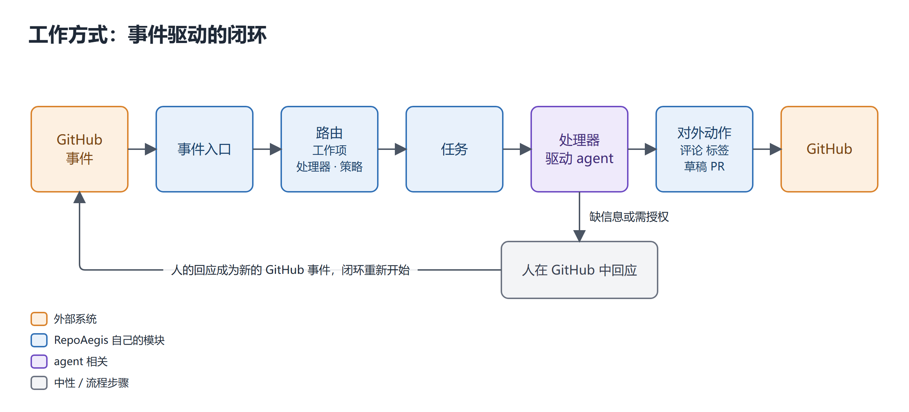

---

## 2. 总体架构

### 2.1 架构图

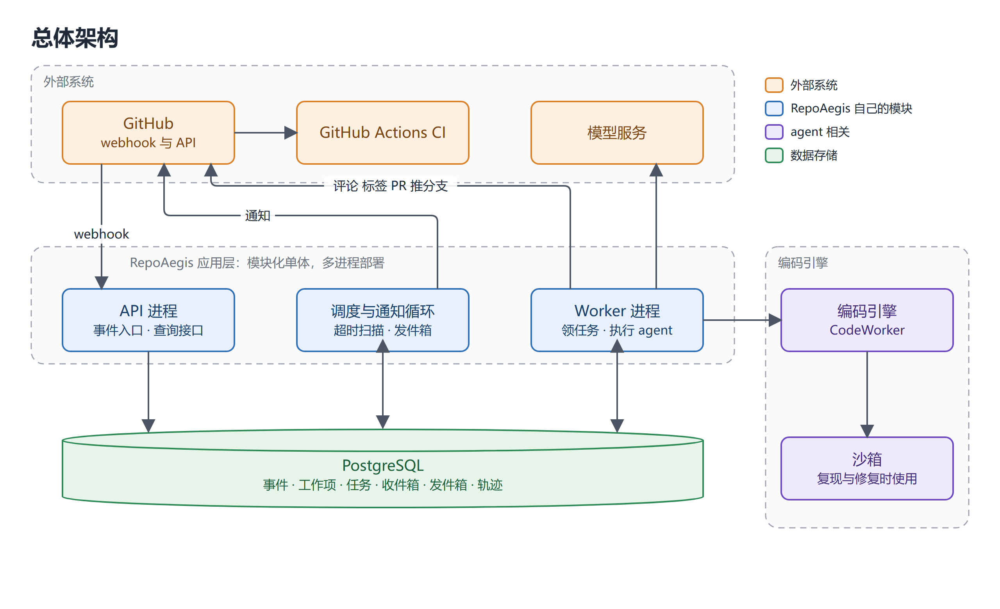

数据库是各进程之间唯一的交接处，进程互不直接通话；任一进程重启，状态仍在数据库中。

### 2.2 进程职责

| 进程 | 职责 |
|---|---|
| API 进程 | 接收 webhook，验签、去重、落库、创建任务；提供查询接口 |
| Worker 进程（可多个） | 原子领取任务并加租约，执行处理器，更新状态，写轨迹与花费 |
| 调度与通知循环 | 扫描超时的收件箱条目并升级；发送发件箱里的通知；初期可并入 Worker 的定时循环 |

### 2.3 接口边界

外部依赖都放在自己定义的小接口之后；外部产品的数据结构不进入自己的库表与 API；同一模块同一时间只接入一种实现。

| 接口 | 职责 | 初始实现 | 可替换为 |
|---|---|---|---|
| `TaskQueue` | enqueue / claim / heartbeat / complete | 数据库表 + 租约 | Redis、RabbitMQ |
| `Notifier` | 向人发送通知 | GitHub 评论 @ | 飞书群机器人 |
| `CodeWorker` | 输入任务与工作区，输出补丁与报告 | 接入 mini-swe-agent | 其他编码 agent、自研 |
| `TraceSink` | 写出轨迹 | 自己的 `spans` 表 | Phoenix、Langfuse（经 OpenTelemetry） |
| `GitHubClient` | 评论、标签、读 issue 与 CI、开 PR | GitHub App 安装令牌 | — |
| `CIVerifier` | 推分支、读取真实 CI 结果 | 读 GitHub Actions 结果 | 本地重放 CI |

### 2.4 容量假设与并发

- 单机起步；每仓库每天几十个事件量级；不为高吞吐做设计。
- 多个 Worker 连同一数据库，靠租约互斥，即最朴素的分布式任务队列；换到 Postgres 即可多机运行。
- 重点是正确性：至少一次投递加幂等；两个 Worker 不得领同一任务；同一工作项同时至多一个活动任务；每个任务使用独立分支与独立工作区，任务之间不共享可写状态；同时运行的任务数有上限；模型限速与退避；长任务有心跳且可取消。

---

## 3. 领域模型

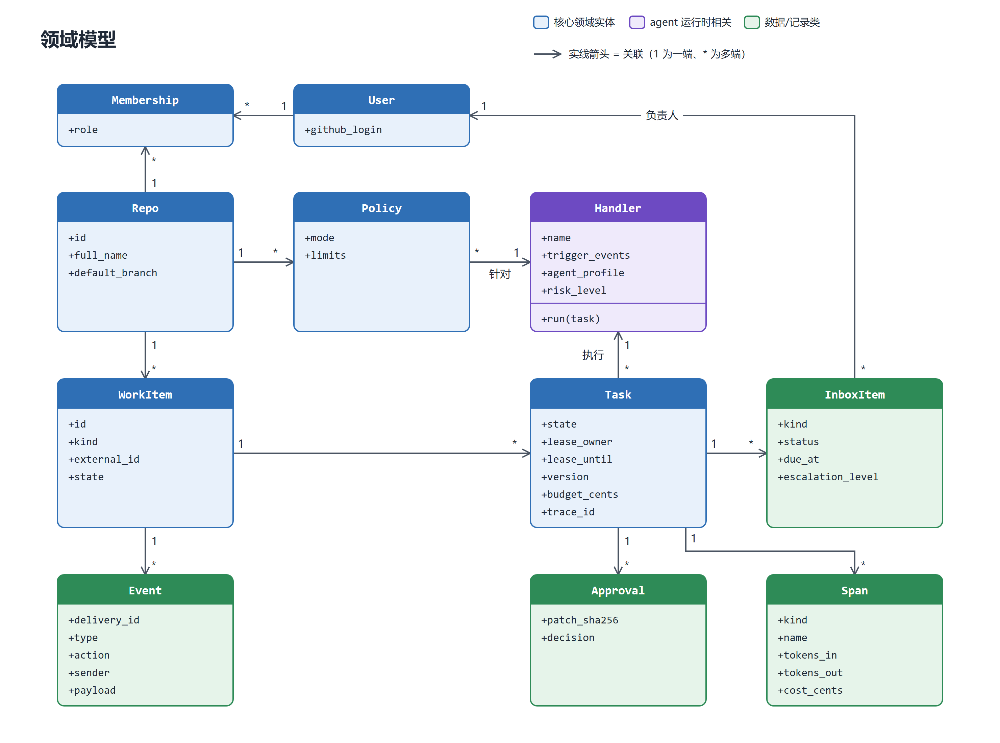

Handler 是代码加配置，不入库表；`Task.handler` 存其名称。

---

## 4. 事件处置、路由与任务状态机

### 4.1 事件处置清单

并非每个事件都交给 agent。只有需要读懂自然语言、探索代码或多步判断的事件才启动 agent；条件和动作都能写成确定规则的，由代码直接处理；与工作无关的事件只记录或不订阅。这样控制成本与延迟，提高可靠性，并减少不可信输入进入 agent 的机会。

| 判断 | 处置 |
|---|---|
| 需要读懂自然语言、探索代码或多步判断 | 交给 agent，创建任务 |
| 条件与动作都能写成确定规则 | 规则处理：更新状态、套模板评论；不创建 agent 任务 |
| 与任何工作项无关，或策略为忽略 | 仅记录，或不订阅 |

**交给 agent**

| 事件 | 启动的处理器 | 为什么需要 agent |
|---|---|---|
| issue 新建 | 分诊（`issue.triage`） | 要读懂描述、查重、分类、判断缺什么 |
| 人对等待中任务的回应（评论或编辑 issue） | 恢复原任务 | 要判断信息是否足够、是否还需追问 |
| 主分支工作流失败，且重跑后仍失败 | `ci.repair` | 要读日志、定位、改代码 |
| RepoAegis 草稿 PR 上的评审意见 | 恢复原任务 | 要理解意见并修改 |
| 分诊确认的 bug 且策略允许 | `issue.reproduce`、`issue.fix`（由任务派生，不是 GitHub 事件） | 要复现、改代码 |
| 外部 PR 新建（后续） | `pr.review` | 要对照约定、评估风险 |
| 依赖更新 PR，CI 失败或大版本（后续） | `dependency.upgrade` | 要读更新日志、找受影响代码、适配 |

**规则处理，不启动 agent**

| 事件 | 处理 |
|---|---|
| 主分支工作流首次失败 | 先请求重跑，排除不稳定测试 |
| 重跑通过 | 记为不稳定测试并通知 |
| 工作流成功，或推送分支的 CI 结果 | 回流到对应任务，驱动状态变化 |
| issue 被人关闭、重开、改标签、指派、锁定 | 取消或暂停任务；人的改动记为纠正 |
| PR 合并或关闭 | 更新工作项；关联 issue 用模板评论收尾 |
| 评论中的命令 | 解析并校验角色，触发对应动作 |
| 依赖更新 PR，补丁或小版本且 CI 通过 | 套模板写说明，建议合并 |
| 收件箱认领或回应超时 | 升级、搁置 |
| 长期无回应的工作项（定时） | 按天数筛选，发模板提醒 |

**仅记录或忽略**

| 事件 | 处理 |
|---|---|
| 发送者是 agent 自己，或依赖更新机器人以外的已知机器人 | 丢弃 |
| 没有匹配处理器，或策略为 `ignore` | 仅记录 |
| star、fork 等与仓库工作无关的事件 | 不订阅 |

MVP 阶段只有"issue 新建"和"人的回应"两类事件进入 agent，其余按规则处理或仅记录。

### 4.2 事件路由

每个事件到达后按下图处理。工作项上发生的各种情形（补充信息、人为关闭或改标签、命令、重开等）都由同一套规则覆盖，不为单个情形写特例。

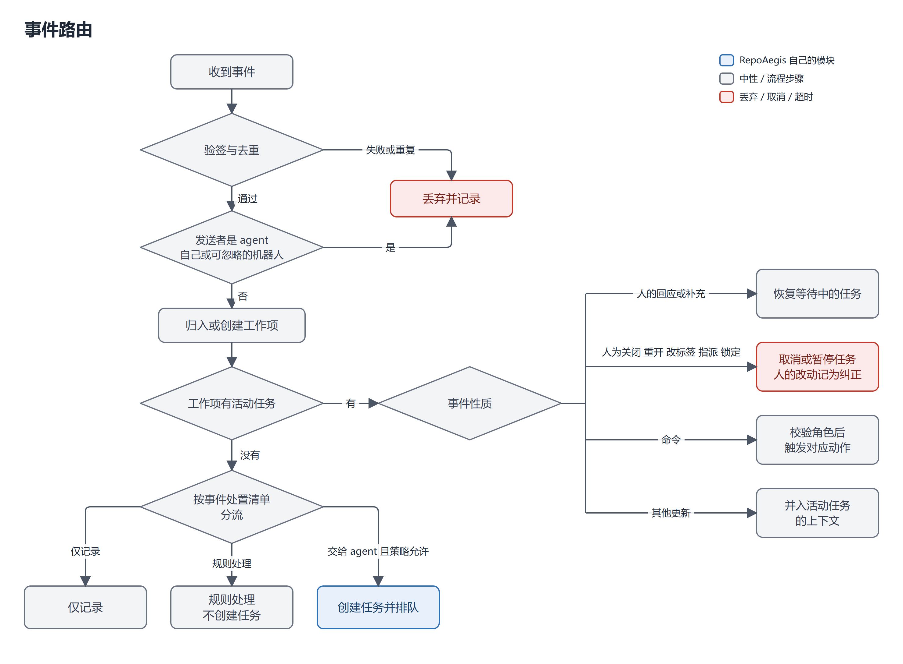

### 4.3 并发规则

| 规则 | 实现 |
|---|---|
| 每个工作项同时至多一个活动任务 | 数据库部分唯一索引：状态属于 queued、running、waiting_human、awaiting_review 的任务，按 `work_item_id` 唯一 |
| 任务之间互不干扰 | 每个改代码的任务使用独立的 `agent/*` 分支与独立工作区；不设仓库级写锁 |
| 同时运行的任务数有上限 | 每个仓库与全局各有可配置的并发上限，防止耗尽沙箱、CI 额度与预算；这是资源限制，不是正确性约束 |
| PR 的合并与冲突 | 由人和 GitHub 处理；agent 不合并 PR。两个 PR 合并后冲突，由人决定顺序或手工解决 |
| 同类事件短时间重复 | 窗口内合并为一个任务 |
| 人为打断优先 | 取消事件可抢占排队中与运行中的任务 |
| 不响应自己 | 发送者是 agent 自己，或依赖更新机器人以外的已知机器人时丢弃，避免自触发循环 |

### 4.4 任务状态机

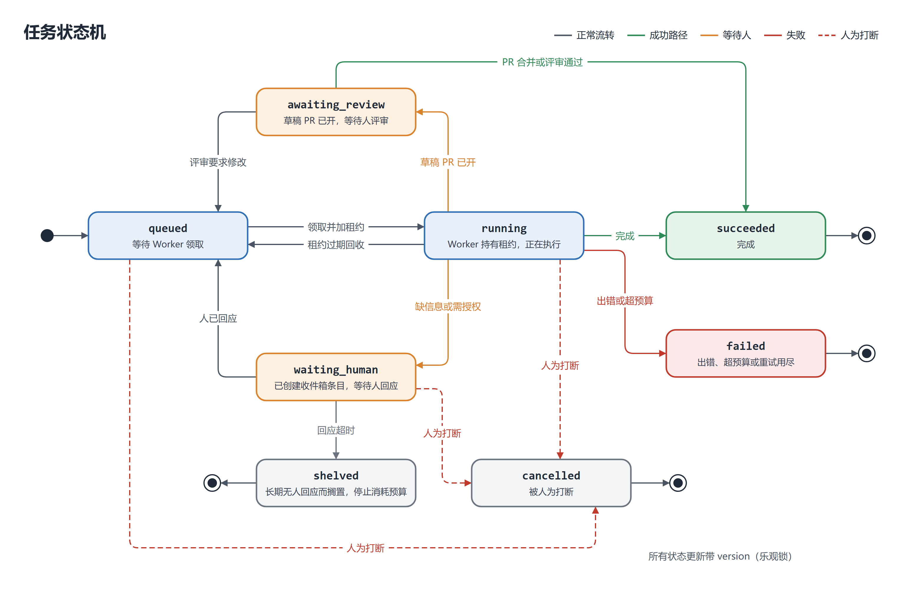

| 状态 | 含义 |
|---|---|
| `queued` | 等待 Worker 领取 |
| `running` | Worker 持有租约，正在执行 |
| `waiting_human` | 已创建收件箱条目，等待人回应 |
| `awaiting_review` | 草稿 PR 已开，等待人评审 |
| `succeeded` | 完成 |
| `failed` | 出错、超预算或重试用尽 |
| `shelved` | 长期无人回应而搁置，停止消耗预算 |
| `cancelled` | 被人为打断 |

所有状态更新带 `version`（乐观锁）。

---

## 5. 核心流程

### 5.1 新 issue：分诊、追问、人的回应

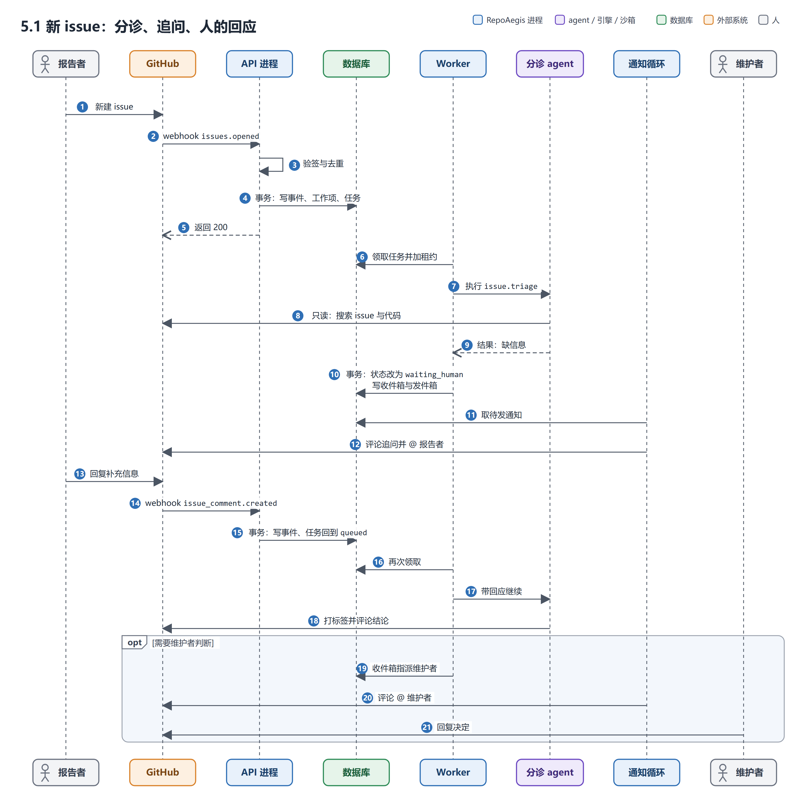

### 5.2 CI 失败：判断不稳定测试，必要时修复

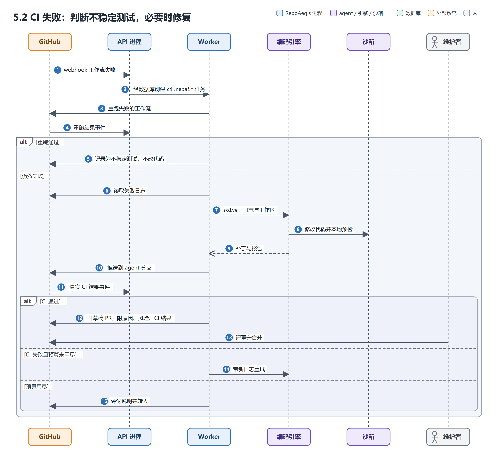

### 5.3 事务与发件箱

通知不在业务事务里直接发出，而是先与业务变更同事务写入发件箱，再由独立循环发送。

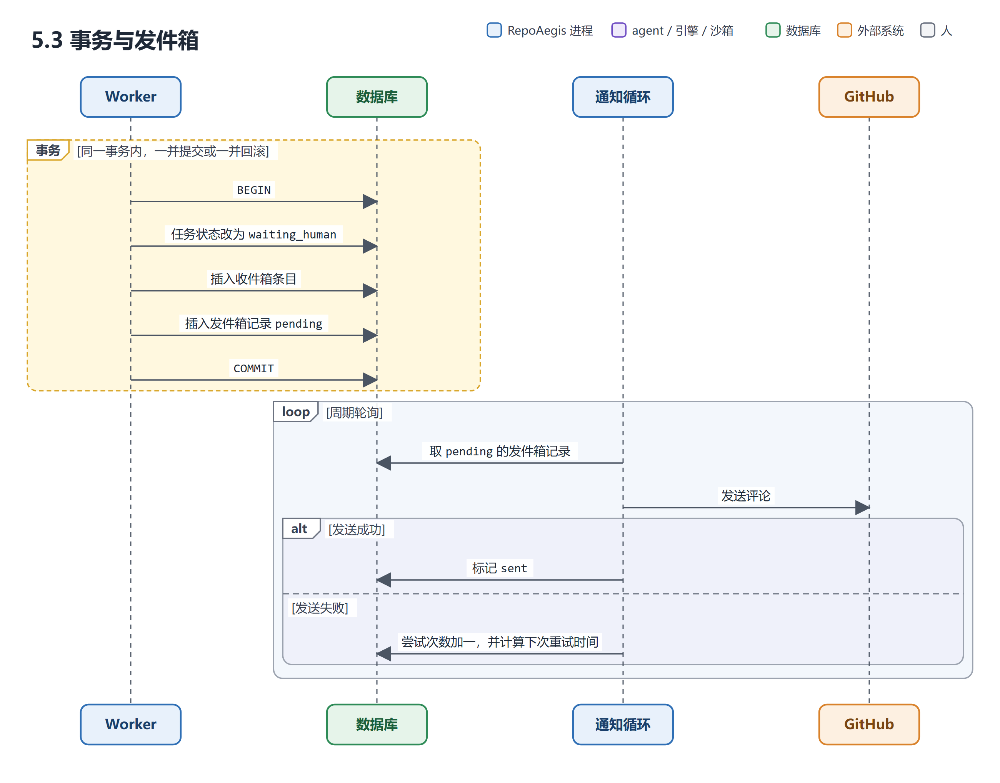

至少发送一次；接收侧需幂等，评论内带隐藏标记，避免重复发送时刷屏。

---

## 6. 数据模型

### 6.1 ER 图

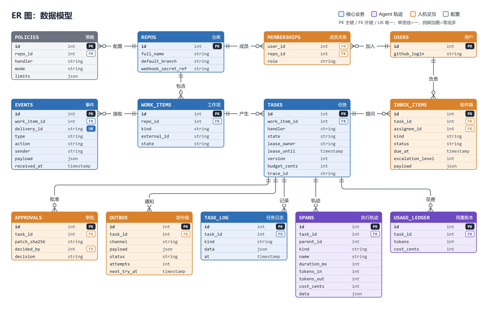

### 6.2 约束

| 约束 | 作用 |
|---|---|
| `events.delivery_id` 唯一 | 重复投递插入失败，天然去重 |
| `work_items` 以（`repo_id`，`kind`，`external_id`）唯一 | 同一对象的事件归入同一工作项 |
| `tasks` 部分唯一索引：活动状态下 `work_item_id` 唯一 | 每个工作项同时至多一个活动任务 |
| 同一任务至多一个待处理的批准 | 避免重复批准 |
| `tasks.version` 乐观锁 | 并发更新时检测冲突 |
| `events`、`task_log` 只增不改 | 审计 |
| 密钥只存引用（`webhook_secret_ref`） | 不存明文 |

### 6.3 事务边界

| 操作 | 同一事务内 |
|---|---|
| 收事件 | 插入 `events`，归入或创建 `work_items`，创建 `tasks` |
| agent 要问人 | 任务置 `waiting_human`，插入 `inbox_items`，插入 `outbox` |
| 人回应 | 更新 `inbox_items`，任务回到 `queued`，写 `task_log` |
| 批准推送 | 校验角色，写 `approvals`（带补丁哈希），状态推进 |
| 取消任务 | 任务置 `cancelled`，关闭相关收件箱条目，写 `task_log` |

---

## 7. 处理器

### 7.1 处理器的组成

每个处理器声明：触发事件、agent 配置（系统提示、可用工具、权限规则）、执行步骤、人的介入点、完成条件、风险等级。新增处理方式只新增处理器与对应策略，核心不变。

### 7.2 处理器清单

| 处理器 | 触发 | 执行内容 | 工具与权限 | 人的介入点 | 阶段 |
|---|---|---|---|---|---|
| 分诊（`issue.triage`） | issue 新建、补充信息 | 分类、查重、追问、打标签、给出文字建议（可疑代码位置与修复思路） | 只读：搜 issue、读代码、读仓库档案；无写权限、无密钥 | 报告者补信息；维护者确认重复与取舍 | MVP |
| `ci.repair` | 主分支工作流失败 | 重跑判断不稳定测试；否则读日志、修复、真实 CI 验证、开草稿 PR | 读日志、`CodeWorker`、`CIVerifier` | PR 评审与合并 | 阶段 M4 |
| `issue.reproduce` | 分诊判定为有复现步骤的 bug | 在沙箱里复现，记录结果 | 沙箱 | 复现失败时的处理 | 阶段 M5 |
| `issue.fix` | 已确认的 bug 且策略允许或维护者同意 | 修复并开草稿 PR | `CodeWorker`、沙箱、`CIVerifier` | 维护者批准、PR 评审 | 阶段 M5 |
| `dependency.upgrade` | 依赖更新 PR，CI 失败或大版本 | 评估变更、升级、验证、写风险说明 | 读变更日志、`CodeWorker`、`CIVerifier` | 取舍：升到哪个版本 | 后续 |
| `pr.review` | 外部 PR 提交 | 跑检查、对照仓库约定、指出风险 | 只读与检查 | 维护者评审 | 后续 |

### 7.3 分诊规则

issue 的类别是分诊的产出，由仓库配置的规则决定下一步。类别集合可扩展，下表是初始集合。

| 类别 | agent 动作 | 回复要点 | 人 | 下一个处理器 |
|---|---|---|---|---|
| 缺信息的 bug | 标 `needs-info`，追问 | 逐条列出缺项，语气礼貌 | 报告者回答 | 补充后重新分诊 |
| 有复现步骤的 bug | 给出可疑代码位置与修复思路 | 贴依据，修复思路只作建议 | 维护者决定修与排期 | `issue.reproduce` → `issue.fix` |
| 疑似重复 | 搜相似 issue，列候选与理由 | "可能与 #N 重复"，不直接关闭 | 维护者确认才关闭 | — |
| 使用问题 | 查文档回答，或引导到 Discussions | 链接加简短解释 | 没把握时转维护者 | — |
| 功能请求 | 打标签，总结需求，查已有 | 说明已记录，是否采纳由维护者定 | 采纳永远是人 | — |
| 文档问题 | 定位位置，必要时提小 PR | 指出具体位置 | 合并由人 | `issue.fix` |
| 安全漏洞 | 不在公开处讨论，只提示按安全政策私下报告，立即通知负责人 | 不复述细节 | 完全由人处理 | — |
| 垃圾或离题 | 标记，建议关闭 | 一句礼貌说明或不回复 | 人确认 | — |
| 长期无回应 | 规则定时提醒一次，之后建议标过期（模板评论，不启动 agent） | 避免机器人式催促 | 人确认 | 规则处理 |

### 7.4 自主程度

| 档位 | 动作 |
|---|---|
| 自己做 | 打标签、追问、查重并提候选、复现 |
| 建议后由人确认 | 关闭、标记重复、安排里程碑 |
| 只给人 | 安全报告、是否采纳功能、合并、推送主分支 |

可撤销、低风险的事 agent 自己做；缺信息、不可撤销、对外有风险的事交给人。每个仓库的实际档位由 `Policy.mode` 配置。

---

## 8. Agent 运行时

自研，配置与事件形状对齐 Claude Code 官方文档（settings 格式、hook 事件名、权限规则语法、子智能体 frontmatter），具体字段实现前读官方文档。

### 8.1 类图

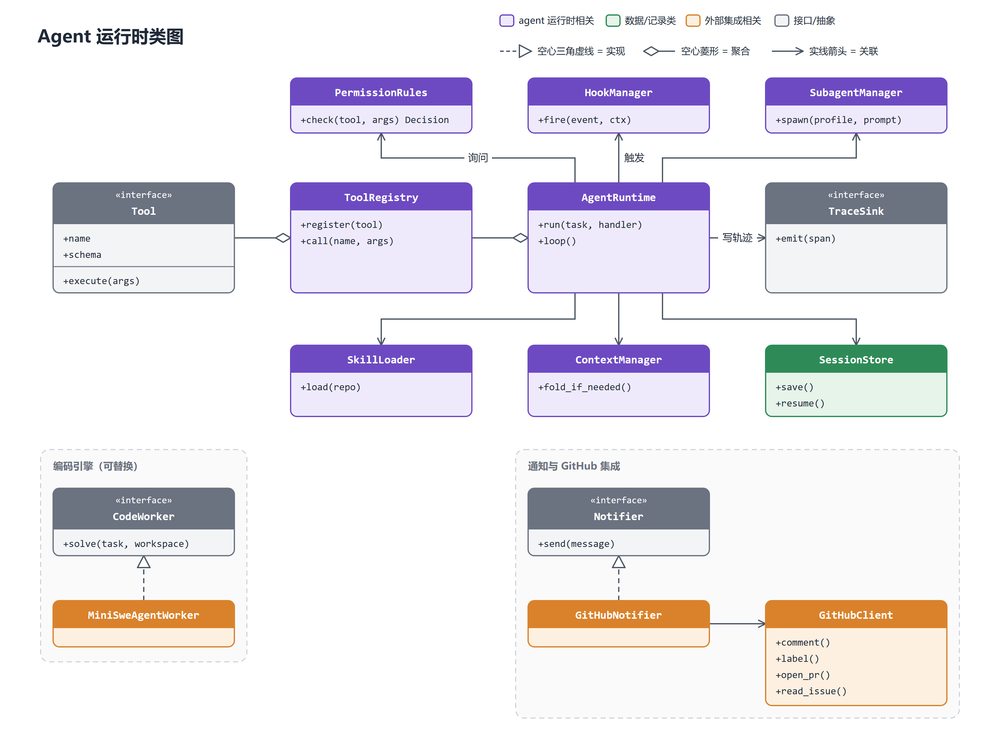

### 8.2 模块

| 模块 | 说明 | 阶段 |
|---|---|---|
| Agent 循环 | 调模型、执行工具、结果回灌、停止条件 | M2 |
| 工具系统 | 统一签名、参数校验、错误回传、结果截断 | M2 |
| Headless 运行 | 无交互，由任务触发 | M2 |
| 权限规则 | 按工具与路径配置 allow / ask / deny，与 `Policy` 同构 | M3 起 |
| Hooks | PreToolUse、PostToolUse、Stop 等节点挂外部命令，可拦截或改写；用于对外动作 | M6 |
| 子智能体 | 独立上下文、限定工具、只回传结论，配置化 | M6 |
| Skills 与仓库档案 | 按需加载；仓库约定自动注入 | M6 |
| MCP 客户端 | 接入外部工具 | M6 |
| 上下文管理 | 超长时折叠；改动消息前缀前先核对缓存成本 | M6 |
| 会话持久化与恢复 | 中断后继续，可回退 | M6 |
| 记忆 | 仓库档案先手写；人的纠正与驳回作为最高优先级的写入信号 | 后续 |

---

## 9. 人机交互

### 9.1 渠道

主渠道是 GitHub：评论提问与回复，PR 评审与合并，评论命令（格式待定）。不以独立控制台为主交互；若有页面，只做只读的管理与观测：任务时间线、策略设置、待处理汇总。

### 9.2 通知对象

| 问题类型 | 对象 | 依据 |
|---|---|---|
| 缺 issue 信息 | 报告者 | 评论中 @ |
| 分诊拿不准、需取舍 | 维护者 | `CODEOWNERS`，或仓库策略中配置的负责人，兜底为管理员 |
| 主分支 CI 失败 | 最近改动相关代码的人，或值班人 | 由 git 历史推断，或配置值班表 |

### 9.3 实时渠道

| 方式 | 说明 | 阶段 |
|---|---|---|
| GitHub 通知 | 评论中 @，零成本 | MVP |
| 飞书群自定义机器人 | 群内添加机器人得到 webhook 地址，POST 即发消息；只用于提醒并附 GitHub 链接 | 可选 |
| 页面实时角标 | 服务端推送 | 后续 |

### 9.4 责任模型

通知可发给多人，负责人同一时刻只有一个。

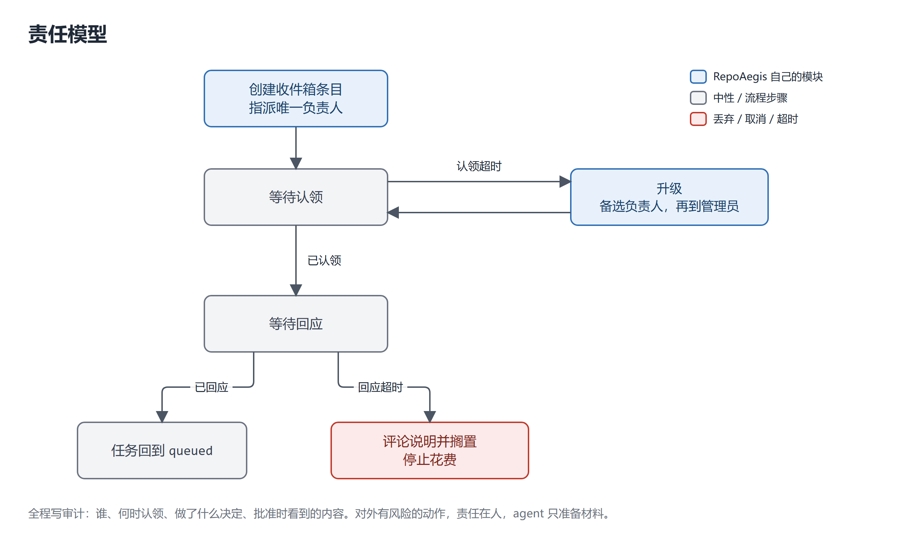

全程写审计：谁、何时认领、做了什么决定、批准时看到的内容。对外有风险的动作，责任在人，agent 只准备材料。

---

## 10. GitHub 集成

### 10.1 订阅的事件

| 事件 | 用途 |
|---|---|
| `issues`（opened、edited、closed、reopened、labeled、assigned、locked 等动作） | 创建与更新工作项 |
| `issue_comment`（issue 与 PR 的评论都会触发，需靠载荷区分） | 人的回应、命令 |
| `pull_request` | PR 相关工作项 |
| 工作流运行完成（待验证具体事件名与载荷） | CI 结果 |
| 依赖更新（待验证） | `dependency.upgrade` |

### 10.2 身份与权限

以 GitHub App 身份运行，用安装令牌，权限最小化；webhook 必须验签；用 `X-GitHub-Delivery` 去重；收到后先落库，30 秒内返回 2xx，处理放到 Worker。

### 10.3 使用的 GitHub 功能

| 功能 | 用法 | 批次 |
|---|---|---|
| Labels | 分诊结果的载体 | 1 |
| Issue 模板与表单 | 从源头减少缺信息 | 1 |
| CODEOWNERS | 路径对应负责人 | 1 |
| Rulesets 与分支保护 | 限制 agent：只能推 `agent/*` 分支，不能推主分支、强推或删分支；必需状态检查 | 1 |
| Checks API | 在 PR 上显示 RepoAegis 自己的检查项，需 `checks:write` | 1 |
| Actions CI | 事件源与验证裁判 | 1 |
| Draft PR | agent 开草稿，人评审后转正 | 1 |
| Dependabot | 依赖更新事件源 | 1 |
| Milestones | 归入版本或阶段，显示进度；agent 只建议，排期由人定 | 2 |
| Sub-issues | 拆大任务，支持多层嵌套 | 2 |
| Projects | 看板展示 agent 工作，按元数据过滤 | 2 |
| Discussions、Releases | 分流问答、起草发布说明 | 2 |
| Issue types | 官方类型；为组织级设置，个人仓库可能不可用 | 待定 |

### 10.4 本地开发

GitHub 无法直接访问本机，用转发工具（smee.io，或 `gh webhook forward`，后者仅限单机，关闭后不存事件）。长期演示再准备公网机器。

---

## 11. 编码引擎与验证

### 11.1 编码引擎

`CodeWorker` 接口之后接入 mini-swe-agent：项目自带循环与 bash 工具，经 litellm 等接入模型，不自带模型。其公开分数是其自身设置下的结果，不作为本系统的指标。另可接一个现成编码 agent 作为黑盒基线，用于对照并验证接口可替换。

### 11.2 验证：本地预检加真实 CI 裁决

- 本地沙箱做低成本预检。已知局限：只装 Python 依赖；断网跑不了依赖外部服务的测试；monorepo 子目录的依赖清单不会安装。
- 以仓库自己的 CI 为最终裁判：修复推到 `agent/*` 分支，由真实 CI 重跑。
- 不稳定测试判断：失败后重跑一次，转绿则记为不稳定，上报而不改代码。

---

## 12. 可观测与评测

### 12.1 可观测

- 业务时间线：`task_log`。
- agent 轨迹：`spans` 表，埋点用 OpenTelemetry 形状；任务表存 `trace_id`。
- 花费与预算：`usage_ledger`，预算控制留在自己系统，不依赖第三方。
- 外部 Ops 平台可选接入（Phoenix、Langfuse），经 `TraceSink` 增加一个出口。

### 12.2 测试与评测

| 对象 | 方法 |
|---|---|
| 确定性部分：状态机、租约、去重、收件箱超时、权限、hooks | 假模型或录制回放，进 CI，要求稳定通过 |
| 分诊 | 标签准确率、查重召回、该追问时是否追问；数据用开源仓库的历史 issue 回放 |
| 不稳定测试判断 | 判断正确率 |
| 维护 PR | 合并后测试是否仍绿、改动大小 |
| 模型相关行为 | 同一任务重复运行 N 次报成功率；改动前后在固定任务集上对比 |
| 回复质量 | 语气与长度的人工抽检 |

评测在成品上进行；编码引擎沿用其公开结果，不重新测。

---

## 13. 安全

- issue 与评论是不可信输入，可能含提示注入。分诊 agent 只读、无密钥；外部评论不当作命令；命令只采纳 OWNER、MEMBER、COLLABORATOR。
- 对外动作（评论、关闭、推送）经权限规则与 hooks。
- Rulesets 限定 agent 只能写 `agent/*` 分支。
- webhook 验签；密钥只存引用，不入日志、不进沙箱。
- 沙箱断网；推送内容与批准绑定补丁哈希，交付前重新计算。

---

## 14. 部署与技术栈

| 层 | 选择 |
|---|---|
| 语言与服务 | Python，FastAPI |
| 存储 | PostgreSQL 加迁移（起步可 SQLite，并发语义按 Postgres 设计） |
| 队列 | 数据库表加租约，经 `TaskQueue` 抽象 |
| 部署 | Docker Compose：API、Worker、数据库 |
| 缓存与实时 | Redis 仅在有真实用途时加（限流、实时推送） |
| 可观测 | 结构化日志、指标、OpenTelemetry |
| 质量 | lint、类型检查、测试、迁移校验，全部进 CI |
| 前端 | 暂缓；以后为只读页面 |

---

## 15. 设计取舍

| 问题 | 选择 | 理由 |
|---|---|---|
| 服务拆分 | 模块化单体，多进程 | 拆微服务带来跨服务事务与调用失败的成本，当前规模无收益；模块边界保留，以后可拆 |
| 队列 | 数据库表加租约 | 入队与业务写入同事务，不会出现"任务写了但消息没发"；量小 |
| 通知 | 发件箱模式 | 业务变更与待发消息同事务，保证至少发一次 |
| 编码引擎 | 接入现成引擎 | 不是差异化部分，也不自带运行时，与自研运行时不冲突 |
| 验证 | 本地预检加真实 CI | 本地环境无法装全；仓库自己的 CI 是最可信的判据 |
| 可观测 | 先写自己的表，OTel 埋点 | 避免过早引入重基础设施；以后接平台只增加出口 |
| 主交互渠道 | GitHub | 维护者本来就在那里 |
| 用途划分 | 处理器注册，不写死几条线 | 事件和处理方式的种类会增长 |

---

## 16. 里程碑

| 阶段 | 内容 | GitHub Milestone |
|---|---|---|
| M0 | 可行性验证：新 issue 触发本机程序并回写评论 | MVP |
| M1 | 事件到任务：验签、去重、落库、状态机 | MVP |
| M2 | 分诊（只读）、agent 循环与工具系统 | MVP |
| M3 | 收件箱、发件箱、超时升级、人的回应 | MVP |
| M4 | `ci.repair`、`CodeWorker`、沙箱、真实 CI 验证 | CI 维护线 |
| M5 | `issue.reproduce`、`issue.fix` | issue 修复线 |
| M6 | 权限规则、Hooks、子智能体、会话恢复等运行时机制 | 运行时机制 |
| M7 | 各模块评测与打磨 | 评测与打磨 |

MVP 只包含分诊，不执行代码，不需要沙箱，不装 Ops 平台，不做控制台。任务清单见 [milestones.md](milestones.md)。

---

## 17. 待验证事项

1. 在测试仓库上实测：webhook 经转发到本机，并用 App 身份回写评论。
2. 工作流运行失败的事件名、载荷字段、失败判定。
3. webhook 签名验证的现行算法与头字段。
4. `CODEOWNERS`、Dependabot、Issue types、Issue 表单的现行行为。
5. GitHub App 注册、权限与安装令牌流程。
6. mini-swe-agent：能否经 litellm 接 DeepSeek；`run()` 是否直接返回补丁；运行环境选项。
7. 飞书自定义机器人：是否免费、@ 所需的用户 ID 与权限、频率限制、是否只能发送。
8. Phoenix 与 Langfuse 的许可证与资源占用（若接入）。
9. 开发机内存与磁盘能否支撑 Docker 与沙箱。
10. 分诊的"文字版修复思路"由分诊 agent 直接给出，还是只指出代码位置、思路留给 `issue.fix`；质量如何评测。
11. 评论命令的具体语法。
12. `Policy.mode` 的粒度：按仓库与处理器，是否还要按标签或路径。
13. 值班表与负责人名单的存放位置：仓库内文件或数据库。
14. 复现失败时的默认动作：追问、关闭还是转人工。

---

## 18. 参考资料

- 发件箱模式：[microservices.io, Transactional outbox](https://microservices.io/patterns/data/transactional-outbox)
- 用数据库当任务队列：[Svix, Postgres message queue](https://www.svix.com/resources/guides/postgres-message-queue/)
- webhook 去重与响应时限：[GitHub Docs, Best practices for using webhooks](https://docs.github.com/en/enterprise-server@3.20/webhooks/using-webhooks/best-practices-for-using-webhooks)
- issue 与评论事件：[GitHub Docs, Events that trigger workflows](https://docs.github.com/en/enterprise-server@3.0/actions/using-workflows/events-that-trigger-workflows)
- Milestones 与 Issue types：[GitHub Docs, Issues quickstart](https://docs.github.com/en/issues/tracking-your-work-with-issues/learning-about-issues/quickstart)
- Sub-issues 与 Projects：[GitHub Docs, About issues](https://docs.github.com/en/issues/tracking-your-work-with-issues/learning-about-issues/about-issues)
- Rulesets：[GitHub Blog, Repository rules are now generally available](https://github.blog/news-insights/product-news/github-repository-rules-are-now-generally-available/)
- Checks API：[GitHub Docs, Getting started with the Checks API（旧版）](https://docs.github.com/en/enterprise-server@3.1/rest/guides/getting-started-with-the-checks-api)
- 本地转发 webhook：[DEV, Test GitHub webhooks locally](https://dev.to/anonymilyhq/how-to-test-github-webhooks-locally-without-port-forwarding-cfd)
- 编码引擎：[mini-swe-agent](https://github.com/SWE-agent/mini-swe-agent)
- CI 修复评测集：[CI-Repair-Bench](https://arxiv.org/pdf/2604.27148)
- 自托管轨迹平台：[Langfuse 自托管文档](https://langfuse.com/docs/self-hosting)
